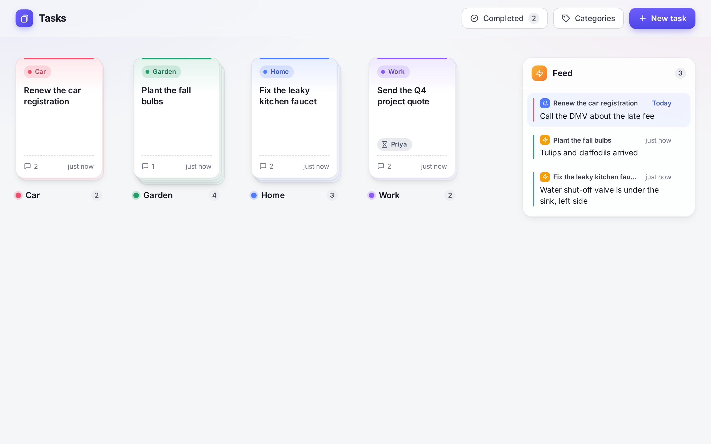
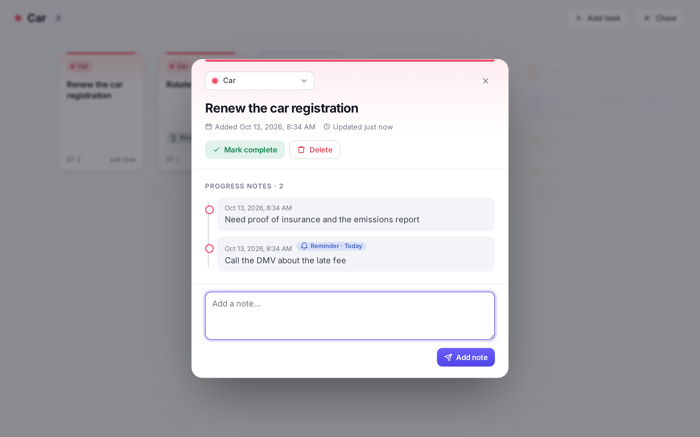
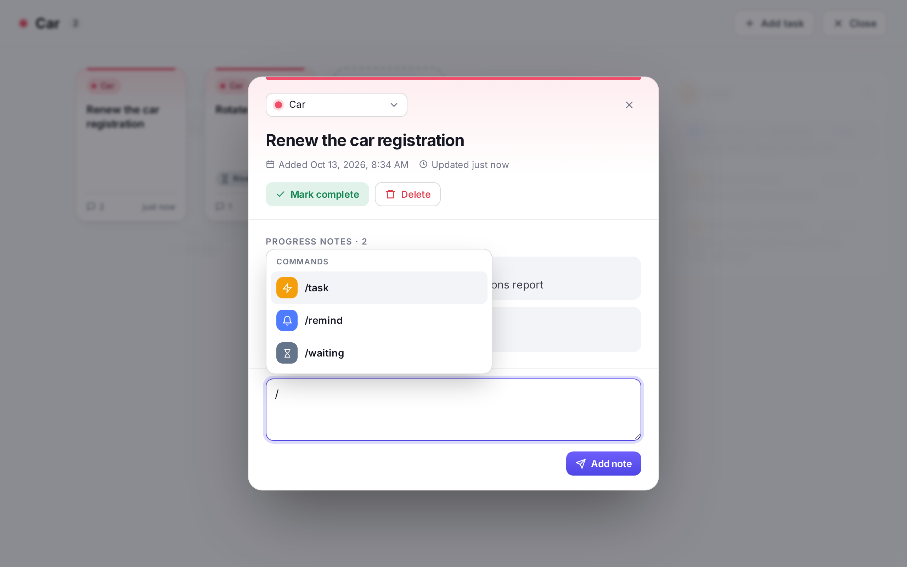
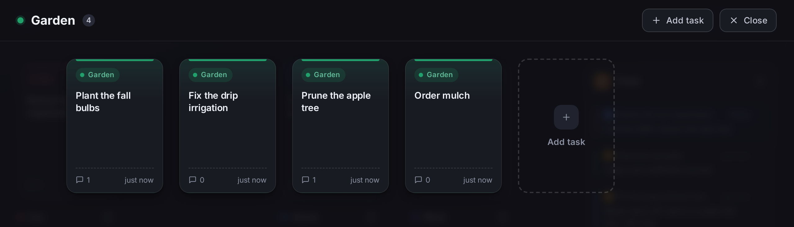
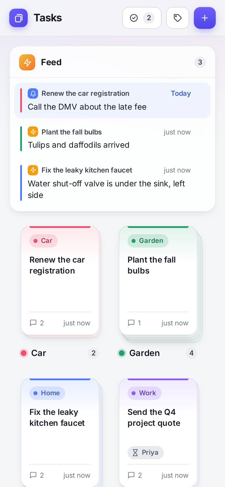

<h1>
  
  Tasks
</h1>

A simple, self-hosted task manager for your home network. Tasks are cards, cards in the same category stack together, and short progress notes keep track of where each task stands.

[](https://github.com/pearljamfever/tasks/actions/workflows/test.yml)
[](https://github.com/pearljamfever/tasks/releases)
[](LICENSE)

<picture>
  <source media="(prefers-color-scheme: dark)" srcset="docs/screenshots/board-dark.png">
  
</picture>

## Features

- **Cards and stacks.** Each task is a card. Cards in the same category stack up, and clicking a stack spreads it out.
- **Progress notes.** Open a task to keep a running timeline of notes on how it's going.
- **Note commands.** Type `/` in a note:
  - `/task` posts the note to the **Feed** on the main page.
  - `/remind tue …` brings the note back to the top of the Feed on the day you pick.
  - `/waiting Sam: …` marks the task as waiting on someone, right on the card.
- **Categories.** Colors, renaming, and a list of completed tasks you can reopen.
- **Works everywhere.** Light and dark mode follow your device, and it works on phones.
- **Simple to run.** One small Node.js server with no dependencies and no database. Your data is one JSON file, backed up daily.
- **Private.** No accounts, no tracking, and nothing loaded from the internet.

## Screenshots

| | |
|:---:|:---:|
| <br>A task and its notes | <br>Note commands |
| <br>A stack spread out (dark mode) | <br>On a phone |

## Install

You need a Linux machine with **systemd** (Ubuntu, Debian, Raspberry Pi OS, …). If it doesn't have Node.js 18 or newer, the installer downloads the current Node.js LTS for the app automatically, without changing the rest of your system.

```sh
git clone https://github.com/pearljamfever/tasks.git
cd tasks
./install
```

Then open the address it prints, e.g. `http://192.168.1.50:3100`. To use a different port: `./install --port 8080`.

The installer runs Tasks as its own locked-down service that starts on boot and keeps daily backups.

**To update later**, run `tasks update` from any folder. It shows the version you have and the newest one, lists what's new, then installs it. Your tasks are kept.

Just want to try it? If you have Node.js, `npm start` runs it on port 3100 from the downloaded folder, with no install.

> [!IMPORTANT]
> Tasks has **no login**: anyone who can reach it can see and edit everything. Run it on your home network only, and use a VPN (e.g. WireGuard or Tailscale) to reach it from outside, rather than opening it to the internet.

## Documentation

- **[Installing and running](INSTALL.md):** settings, upgrading, backups and restoring, uninstalling, security, troubleshooting
- **[Using Tasks](docs/USAGE.md):** tasks, note commands, the Feed, categories
- **[Changelog](CHANGELOG.md):** what changed in each version

## License

[MIT](LICENSE). The bundled [Inter](https://rsms.me/inter/) font is licensed separately under the [SIL Open Font License](public/fonts/LICENSE-Inter.txt).
