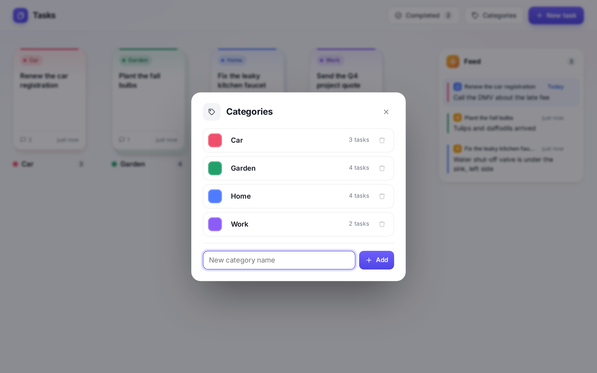

# Using Tasks

Tasks are cards. Cards in the same category stack together, and clicking a stack spreads the cards out.

## Tasks

- **New task** (top bar) adds a task. Pick its category from the dropdown, or choose **+ New category…** to make one on the spot.
- Click a **stack** to spread its cards out. Click **Close**, press **Esc**, or click an empty spot to stack them back up.
- Click a **card** to open the task. From there you can:
  - Rename it by clicking the title.
  - Move it to another category with the dropdown at the top.
  - **Mark complete** or **Delete** it.
  - Add notes to track progress. **Ctrl + Enter** adds a note without reaching for the button.
  - Start a note and come back later: anything you haven't added yet is kept as a draft, even if you close the task. Drafts last until the page is reloaded.

## Note commands

Type `/` in the note box to open the command menu. Use the arrow keys and **Enter** (or click) to pick one. Picking a command puts a colored tag above the note box. Click the **×** next to its name to cancel it.

| Command | What it does |
|---|---|
| `/task` | Posts the note to the **Feed** as well as saving it on the task. |
| `/remind` | Saves the note and puts it at the **top of the Feed starting on the date you pick**. It stays there until you dismiss it. The tag has a date box that starts on tomorrow. |
| `/waiting` | Marks the task as **waiting on someone**. Type the name in the tag's **Who?** box, then the note. The note is optional; on its own it saves "Waiting on *name*". |

**Typing a command out in full.** Instead of using the menu, you can start the note with the command. It has to be at the very start of the note.

- `/task Bring proof of insurance`
- `/remind tue Call the plumber back`
- `/waiting Sam: sending over the quote`
  - The name goes before a `:`, `,` or ` - `. With nothing after it, the whole thing is the name.

**Dates `/remind` understands:**

| Type | Examples |
|---|---|
| Today / tomorrow | `today`, `tomorrow` (or `tmrw`) |
| A weekday (always the next one, never today) | `tue`, `friday`, `next fri` |
| Days or weeks from now | `3d`, `2w` |
| A date | `10/14`, `10/14/27`, `oct 14`, `2026-10-14` |

A date with no year that has already passed this year means next year.

**Waiting on someone:**
- The card shows the person's name with an hourglass.
- Open the task and click **×** on the "Waiting on …" badge when you're no longer waiting.
- Marking the task complete also clears it.
- Posting another `/waiting` replaces the name.

**Tags on notes.** In a task's notes, each command note gets a small tag: **In feed**, **Reminder · date**, or **Waiting on *name***.

## Feed

- Shows `/task` notes, newest first, and `/remind` notes once their day arrives.
- Due reminders sit **at the top**, highlighted, with their date ("Today", "Yesterday", …), until you dismiss them.
- Reminders on a completed task don't show. Reopen the task and they come back.
- The small icon on each entry shows which command posted it. The colored bar on the left is the task's category.
- Click an entry to open its task. Hover it and click **×** to dismiss it from the Feed. The note stays on the task.
- The Feed refreshes itself every minute, so a reminder appears on its day even if the page has been left open.
- On a computer the Feed sits on the right side of the page; on a phone or narrow window it sits above the stacks.

## Completed

- **Completed** (top bar) lists finished tasks, newest first. The number on the button is how many there are.
- **Reopen** puts a task back on the board. Click a task's title to open it and read its notes.

## Categories

- **Categories** (top bar) is where you add, rename, recolor and delete categories.
- Click a category's **color square** to pick a new color. Click its **name** to rename it.
- A category can only be deleted once it has no tasks (open or completed). Move or delete its tasks first.
- Names must be unique, ignoring capitalization ("Car" and "car" count as the same).

## Light and dark mode, phones

The app follows your device's light or dark setting, and works on phones. On a phone, the Feed sits above the stacks.

## Several tabs or devices

Changes made in one tab or on one device show up in the others when you switch back to them.
